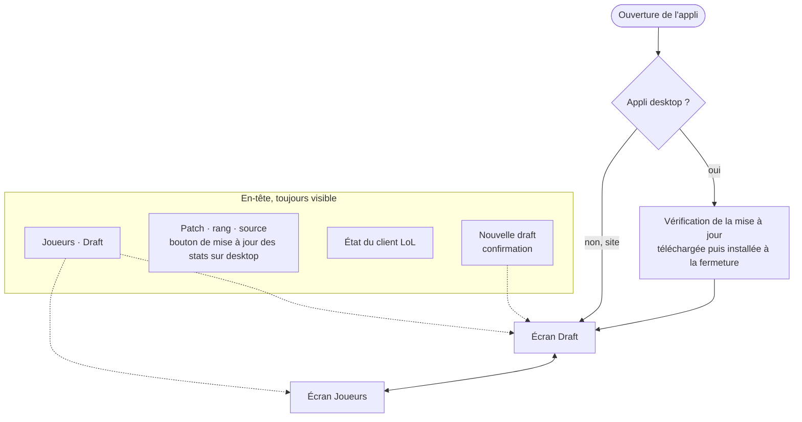
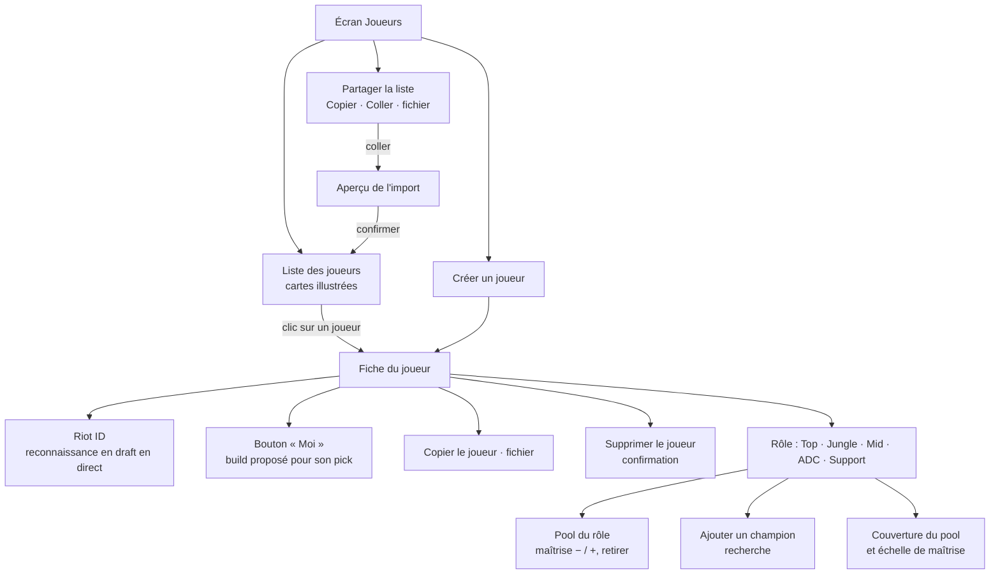
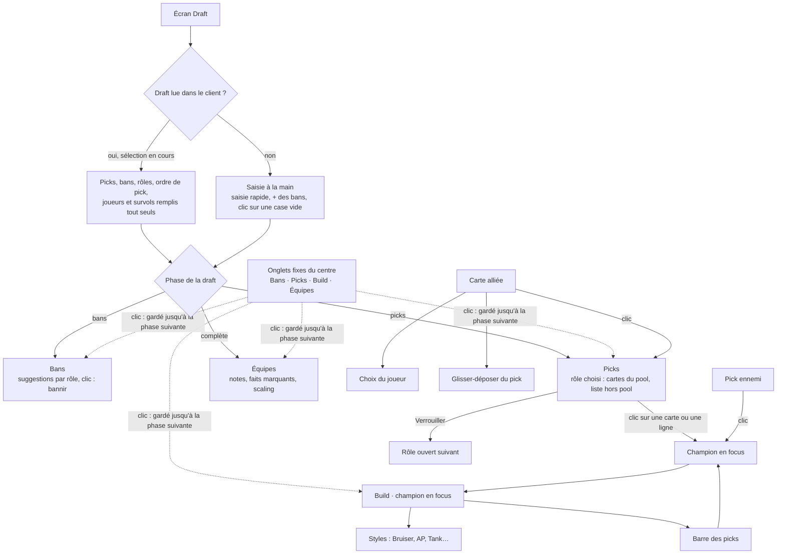

# User flow : navigation dans l'appli

État au 29/10/2026 (après l'appli 0.5). Deux écrans, choisis dans l'en-tête : **Joueurs** et **Draft**. La draft se remplit à la main ou toute seule depuis le client LoL (appli desktop ou `npm run bridge`).

## Vue d'ensemble

## Écran Joueurs

## Écran Draft

## Règles de navigation

- **Onglets fixes** : Bans, Picks, Build et Équipes sont toujours visibles. L'onglet actif suit la phase (bans, puis picks, puis draft complète). Un onglet choisi d'un clic reste affiché jusqu'au changement de phase suivant.
- **Champion en focus, partagé par Picks et Build** : un clic sur une suggestion (carte ou ligne), sur un portrait de la barre des picks ou sur un pick ennemi le choisit. Sans clic : ton pick (joueur connecté au client, sinon « Moi »), sinon le champion du rôle choisi ou affiché (verrouillé, sinon la meilleure suggestion).
- **Choisir un rôle** (carte alliée) ouvre Picks sur ce rôle ; son pick verrouillé devient le champion en focus.
- **Après un verrouillage** depuis le centre, le rôle ouvert suivant s'affiche dans Picks.
- **Build d'un ennemi** : calculé de son point de vue (son équipe, ton équipe en face).
- **Build sur un seul écran** : barre des picks des deux équipes au-dessus, en-tête (champion, styles), puis runes principales en cartes, sorts / départ / bottes, chemin d'objets avec les 4e à 6e objets, et situationnels ; les autres options en petites icônes après « ou ».
- **Écran Joueurs** : les changements sont enregistrés tout de suite sur l'appareil ; la draft en cours est gardée en changeant d'écran.
